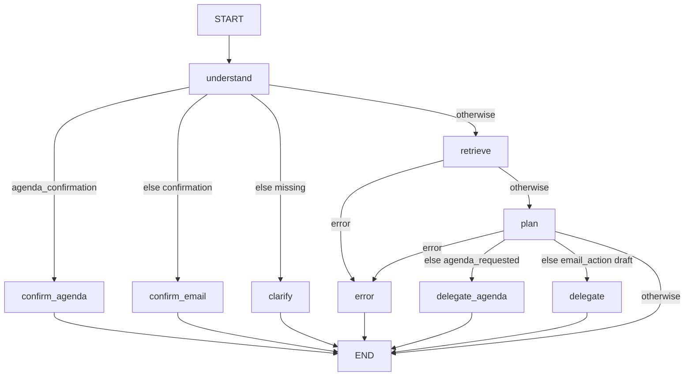
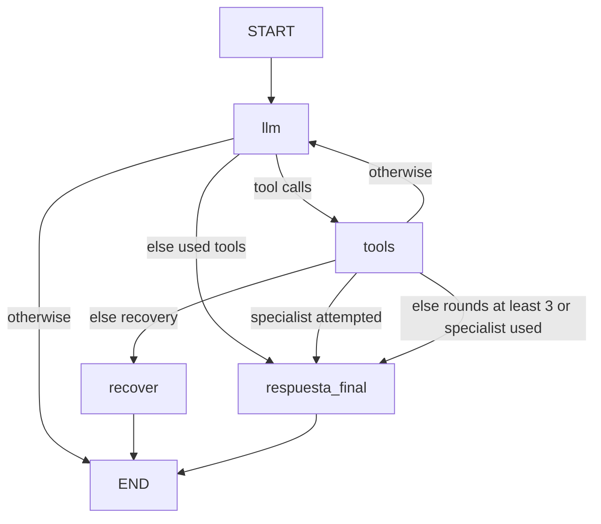
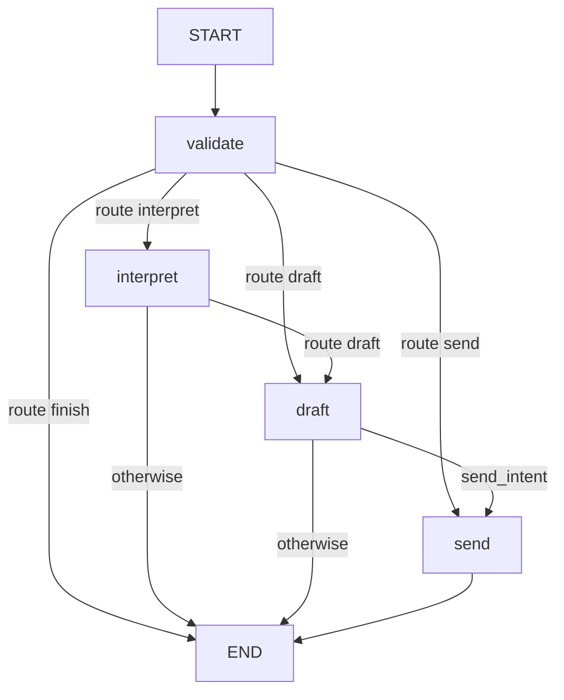
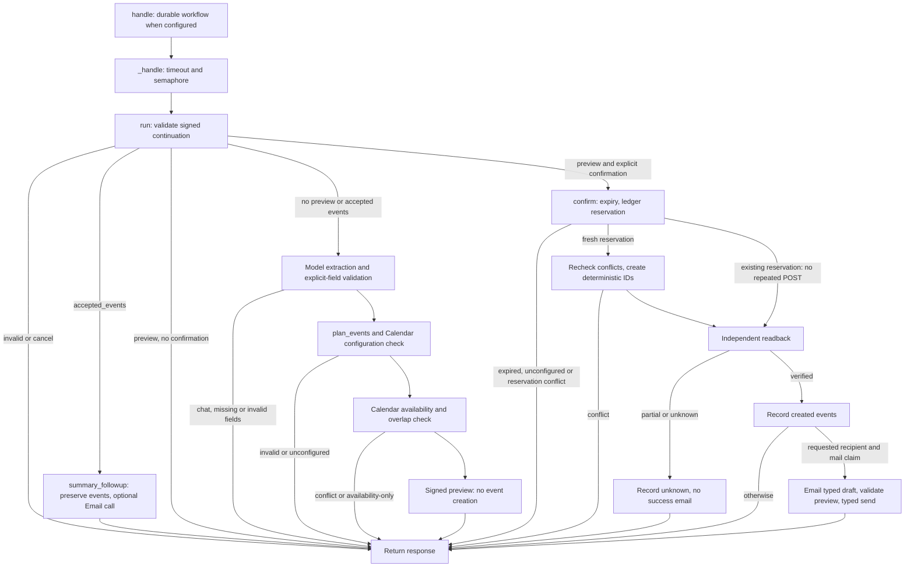

# Colombia A2A: flow and resumption context

This repository teaches independent Itinerary and Email agents communicating over
the official A2A SDK, with optional Agenda and a separate local UI prototype.
Itinerary plans; Email owns mail execution; Agenda owns Calendar effects and its
requested schedule-summary email. There is no fourth orchestrator service.

This documentation unit preserves the populated `tourism_agent/`, `email_agent/`,
`agenda_agent/`, `common/` and `demo_ui/` roots. It does not change runtime behavior,
imports, prompts, tools, permissions, model selection, fallback or deployment.
It does not introduce a shared framework or claim live provider acceptance.

## File map and boundaries

[AGENTS.md](AGENTS.md#responsibility-boundaries) maps contributor responsibilities.
The main entrypoints are `tourism_agent/app.py`, `email_agent/app.py` and
`agenda_agent/app.py`, each composed by its package `__main__.py`.

| Follow this concern | Source |
|---|---|
| Typed trip graph/state/nodes | `tourism_agent/service.py` (`TripState`, `TourismService`) |
| Native trip graph/state/tools/prompt | `tourism_agent/conversation.py` (`Turn`, `NativeConversation`, `TOOLS`, `SYSTEM`) |
| Retrieval | `tourism_agent/catalog.py`, `tourism_agent/mcp_catalog.py` |
| Email graph/state/nodes and current-human checks | `email_agent/service.py` (`MailState`, `EmailService`) |
| Email approval and provider evidence | `email_agent/approval.py`, `email_agent/dispatch_ledger.py`, `email_agent/gmail_transport.py` |
| Async scheduling and effects | `agenda_agent/service.py` (`AgendaService`), `agenda_agent/planning.py`, `agenda_agent/calendar.py` |
| Agenda typed contracts and signed/effect state | `agenda_agent/contracts.py`, `agenda_agent/signing.py`, `agenda_agent/ledger.py` |
| Model factory, operation prompts and bounds | `common/model.py` (`ModelPort`), `common/config.py` |
| API contracts and shared runtime | `common/contracts.py`, `common/runtime.py`, `common/auth.py` |
| SDK delegation and durable business state | `common/a2a_transport.py`, `common/workflows.py`, `common/firestore_workflows.py` |
| UI lifecycle, channels and persistence | `demo_ui/app.py`, `demo_ui/agents.py`, `demo_ui/auth.py`, `demo_ui/store.py`, `demo_ui/static/` |
| Existing teaching/client adapters | `examples/README.md`, `integrations/agentic-front/README.md` |

## Itinerary: typed LangGraph

Source: `TourismService.__init__` in `tourism_agent/service.py`. An empty `message`
selects this graph; nonempty text selects native conversation or a
`conversation_model_required` error when that model is unavailable. The diagram
shows builder branches, not proof that every flag is reachable from every input.
In particular, `understand` currently returns context/missing fields, not the
confirmation flags tested by the builder.

Retrieval supplies catalog evidence; model selection supplies source IDs and
`none|draft`. Python validates grounding and builds the itinerary. Typed draft
intent does not silently become send authority. Catalog fixture fallback is
provenance-labelled retrieval, not a replacement for failed live model inference.

## Itinerary: native conversation LangGraph

Source: `NativeConversation.__init__` in `tourism_agent/conversation.py`. Durable
session/version/replay checks wrap execution. Names below are actual graph nodes;
edge labels follow the builder's priority order.

`generar_itinerario` executes retrieval/planning; `consultar_correo` and
`consultar_agenda` delegate with the current human request and private state.
These are bounded existing tools, not new permissions. `recover` is text-only;
`respuesta_final` summarizes authoritative evidence with tools disabled and keeps
the original structured result if summarization is invalid. A final reply cannot
reopen delegation. Agenda ownership prevents duplicate schedule-summary mail.

## Email: LangGraph

Source: `EmailService.__init__` in `email_agent/service.py`. Typed and native-chat
entry paths share these four nodes. The interpreter chooses intent/content source;
Python, not a model-generated confirmation flag, enforces current-human evidence
and exact approval/recipient/session/configuration checks.

Chat draft can return content without a recipient. A sufficient current-human
send request can proceed in one turn; typed send still requires the exact signed
preview and confirmation. A rendered itinerary does not need an extra drafting
LLM call. Reservations precede effects; `delivery_unknown` must not trigger resend.

## Agenda: async service, not LangGraph

Source: `AgendaService.handle`, `_handle`, `run`, `confirm`, `readback` and
`summary_followup` in `agenda_agent/service.py`. The diagram is a service-flow
summary, **not** a compiled graph. `ModelPort` uses LangChain for extraction; that
does not make the scheduling use case a LangGraph workflow.

Exceptions may also return errors/uncertainty; readback is attempted after creation
errors. A partial or unknown batch is not success. Availability and creation are
not atomic; exactly-once scheduling is not promised. The continuation permits
readback without repeating event POSTs. Calendar and Gmail keep separate grants,
signing and ledgers; Email retains its own validation and provider responsibility.

## Evidence and limits at this documentation boundary

- **Static observation:** the three builders above define the Itinerary/Email
  LangGraphs; Agenda implements async Python branching without a StateGraph.
  Existing package roots already separate substantive responsibilities.
- **Historical context:** inherited README, security and release guides describe
  deterministic tests with injected models/providers, not live acceptance. No
  historical suite count or CI result is promoted to a fresh result here.
- **Current checks:** this unit uses source/document readback, local-path and
  command-copy checks, graph/qualifier comparison, whitespace and status inspection.
  Exact observations belong in the implementation handoff, not a blanket runtime
  PASS claim. No Python, uv, model, transport, OAuth, Calendar or mail test was run
  for this passive unit. The copied runtime commands in AGENTS.md remain **unrun**.
- **Limits:** fixture mode is not a natural-language router; conversational tests
  inject explicit decisions. Catalog data does not verify prices, opening hours,
  safety, availability or reservations. Provider acceptance does not prove inbox
  delivery. Real UI OAuth, Calendar authorization, owner-only cloud acceptance and
  deployed UI readiness are not established by this source.

## Next resumption

1. Inspect the working tree and the root guides; preserve unrelated changes.
2. For an authorized behavior task, use the exact existing offline commands in
   [AGENTS.md](AGENTS.md#exact-existing-offline-checks) after environment readiness
   is established. Record new results separately from this static inspection.
3. Keep request/session/version and operation receipts when investigating effects;
   query the original durable record, never bypass an uncertain reservation.
4. Consult [architecture](docs/architecture.md), [durable recovery](docs/durable-workflows.md),
   [Gmail consent](docs/gmail-authorization.md), [Calendar consent](docs/calendar-authorization.md),
   [UI boundaries](demo_ui/README.md), [security](SECURITY.md) and
   [release limits](docs/public-release.md) before expanding scope. Source changes
   authorize no account use, credential access, deployment or license decision.
