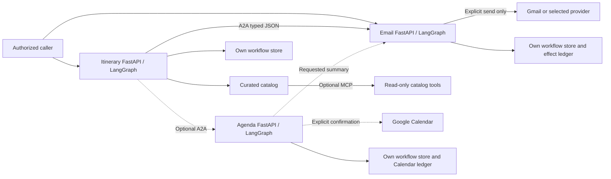
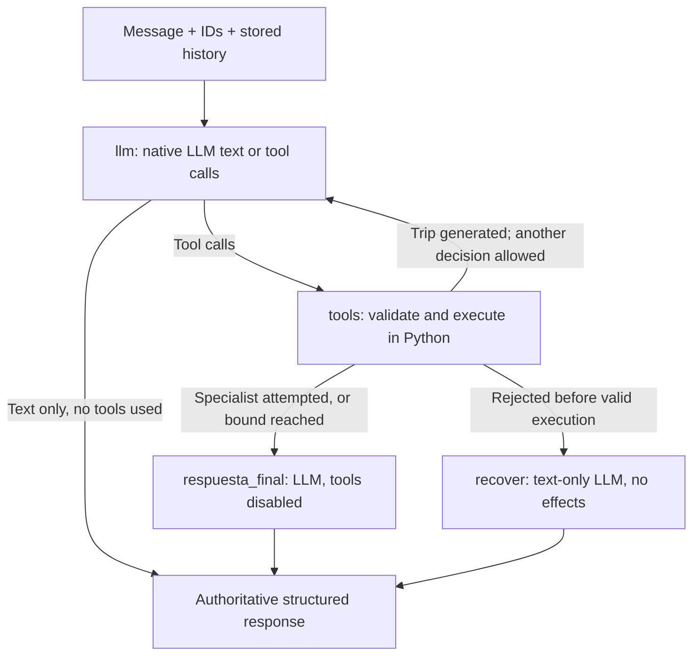
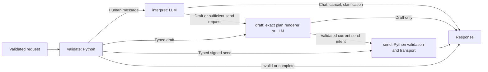
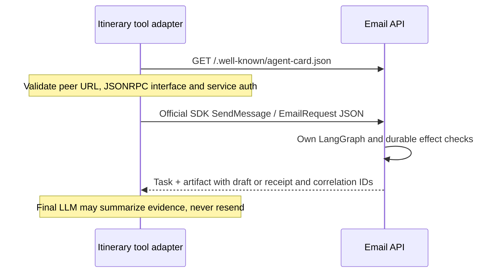

# Independent agents, explicit effects and durable evidence

The primary use case is **Itinerary -> Email** over A2A, with both agents usable
alone. Optional Agenda owns scheduling and its requested completion email. There
is no fourth orchestrator service. This describes the current local source, not a
claim that all features or authentication paths are already published.

## Boundary map

| Process | Input | Output / exclusive responsibility |
|---|---|---|
| Itinerary | Human `message`, or typed city/days/interests with an empty message | Text, itinerary, optional specialist result; never sends directly |
| Email | Human message or typed `EmailRequest` | Chat, draft, preview, receipt or uncertainty; owns provider execution |
| Agenda | Human message or typed schedule | Clarification, conflicts, preview, verified events; owns the schedule's summary email |
| Standalone UI | Google owner session and structured forms | Own workspace; exact server-held draft and explicit send button |

Core use cases live in service modules, not HTTP handlers. Shared `common/` owns
contracts, authentication, model composition, correlation, bounded runtime and
workflow stores. Data from a tool, source, old message or model is not permission.

## Native Itinerary: which nodes use an LLM?

[`tourism_agent/conversation.py`](../tourism_agent/conversation.py) compiles the
native graph for nonempty `message`. Its public tools are bounded application
capabilities, not direct provider credentials.

| Node / capability | Input -> output | LLM? |
|---|---|---|
| `llm` | Current human + bounded passive history/reference -> text or native tool call | Yes |
| `tools` / `generar_itinerario` | Valid city/days/interests -> sourced itinerary; no Email/Agenda | Python executes; underlying planner uses LLM selection |
| `tools` / `consultar_correo` | Verbatim current human + available plan/private continuation -> Email response | Python A2A adapter; Email has its own model |
| `tools` / `consultar_agenda` | Current human + optional plan -> Agenda response | Python A2A adapter; Agenda has its own model |
| `respuesta_final` | Verified plan/status/receipt -> replacement `message` only | Yes, tools disabled; preserves original response on invalid summary |
| `recover` | Rejected tool decision + passive plan -> safe text | Yes, no retry or effect |

A greeting may end after one model decision. A plan-and-email request may generate
first, return to the decision model, delegate once, then summarize without tools.
The native flow limits tool rounds and tracks attempted specialists. The final
node cannot reopen delegation. Structural status, preview, IDs and receipt remain
authoritative even when a natural-language summary fails validation.

### Typed Itinerary remains a separate path

An empty `message` selects [`tourism_agent/service.py`](../tourism_agent/service.py):
`understand -> clarify` or `retrieve -> plan -> optional delegate`. `retrieve`
uses the catalog; `plan` calls the model to select only supplied source IDs and
`email_action=none|draft`. Python validates those IDs, constructs days and applies
warnings. Draft delegation requires explicit structured intent and recipient;
it cannot silently become a send. Typed confirmation and optional Agenda have
their own bounded branches. The UI uses this typed no-send path for generation.

## Email: one intent decision, one possible effect

[`email_agent/service.py`](../email_agent/service.py) has four graph nodes:

The model chooses `chat`, `draft`, `send` or `cancel` and whether requested content
comes from the current message, itinerary or existing draft. It does not supply
recipient authority, signatures or confirmation flags. Python checks schema,
verbatim current human evidence outside quotes, address consistency, session,
configuration and idempotency. This is **not** a regex intent router. Regex remains
for structural checks and guardrails, not choosing the email action.

A free-topic draft uses an LLM. Email renders an available itinerary exactly rather
than making an unused second drafting call. For questions about a previous send,
the interpreter receives its sanitized receipt for its original recipient. That
receipt is not permission to repeat an action. A current human instruction can
send without a redundant approval turn; typed clients still prove approval over
the exact signed payload. Drafting without a recipient never sends.

## A2A discovery is not MCP tool discovery

[`common/a2a_transport.py`](../common/a2a_transport.py) uses the official SDK's
AgentCard resolver and `SendMessage`. The configured peer URL and card interface
must agree; redirects and unapproved interfaces are rejected. Input is one JSON
data part matching the Pydantic contract, not arbitrary `TextPart` instructions.
The response is a task artifact containing the same typed business response.
A2A 1.0 JSONRPC uses `SendMessage`, not the old `message/send` method.

- **AgentCard / skills:** agent capabilities and contact/auth metadata.
- **MCP `list_tools`:** callable catalog tool schemas from an optional MCP server.
- **LangChain tools:** local functions exposed to the decision LLM. One wraps
  A2A; another executes the itinerary planner. There is no invented agent-list API.

[`tourism_agent/mcp_catalog.py`](../tourism_agent/mcp_catalog.py) bounds read-only
MCP retrieval, schemas, tool count, time and result size. `ENABLE_MCP=false` skips
it. Curated fixture fallback records provenance; it never replaces a failed live
LLM or claims current travel facts. External content cannot authorize email.

## Memory, business IDs and duplicate prevention

Each service uses [`common/workflows.py`](../common/workflows.py) with local SQLite
or [`common/firestore_workflows.py`](../common/firestore_workflows.py) with an
explicit dedicated project/database. Default Firestore is rejected. Stores retain
plan, pending tasks, approvals, bounded history, versions and execution evidence.
They are private: messages and signed continuations must not be published.

| ID / evidence | Purpose |
|---|---|
| `request_id` + `session_id` | Durable business conversation in that service |
| `plan_version` | Reject stale updates and approvals |
| `operation_id` | Reserve/replay an exact operation; child phases get correlated IDs |
| `a2a_task_id`, `a2a_context_id` | SDK transport correlation, not the durable workflow authority |
| Preview + token | Bind exact content, recipient, session, configuration and expiry |
| Provider receipt / effect ledger | Record accepted, reserved or unknown effect separately |

The native A2A task cache is bounded and ephemeral (128 entries, ten-minute idle
TTL). Do not rely on `GetTask` after restart. Use authenticated
`GET /api/requests/{request_id}?session_id=...` for the durable record.

A store transaction reserves **before** the external call and saves its receipt
**after** it. Gmail and Calendar have separate effect ledgers. A crash between
reservation, effect and receipt can leave an uncertain outcome even when nothing
was sent. Unknown/reserved outcomes do not automatically retry or unlock. Do not
delete state or generate new IDs to bypass this. Independent fresh requests are
not globally deduplicated by text; exactly-once delivery is not promised.

For direct Itinerary -> Email, Itinerary owns delegation. For
Itinerary -> Agenda -> Email, Agenda owns the one requested schedule summary;
Itinerary preserves that result rather than sending another copy.

## Web and deployment trust boundaries

[`demo_ui/`](../demo_ui/) is a local structured UI with its own server-only keys,
Google Web OAuth, explicit owner allowlist, hashed session, Origin/CSRF checks,
Firestore state and transactional send reservation. The browser never receives
signed approvals or agent credentials. Itinerary and draft forms cannot send;
only **Enviar este correo** posts the exact server-held proposal. This is not an
unrestricted native chat UI. Real Google acceptance and UI deployment are pending.

The hub only links to and back from that independent UI. Its fixed return URL
is not a user-controlled redirect. No iframe, shared session or hub proxy is used.

`X-API-Key` protects business APIs and A2A; it is a service credential, not personal
Google authentication or tenant isolation. Cards, Swagger and health are public
metadata. The code supports optional outbound peer IAM, but private cloud IAM
rollout and real owner-only acceptance are pending verification. The source UI
prototype uses Web OAuth, not IAP; an IAP proposal is not an implemented feature.
No public link or workflow file is proof of a deployed revision.

## Optional Agenda and intentional limits

Agenda is a separate API with Calendar credentials, approval key and ledger. It
can converse without Itinerary. Dates, IANA timezone, time and durations must be
explicit. It checks conflicts, returns a proposal and creates events only after a
specific confirmation. Partial or uncertain creation is not success and does not
trigger a success email. Calendar authorization/live acceptance remain separate
operator work; this source candidate performs no events or real mail.

Deployment project, sender, owner and destinations are explicit own configuration.
The model whitelist, verified OAuth identity, signed payload and service-key checks
remain enforced; no instructor identity or hosted origin is a default. See [release limits](public-release.md) and the
[security policy](../SECURITY.md) before adapting or publishing this source.
