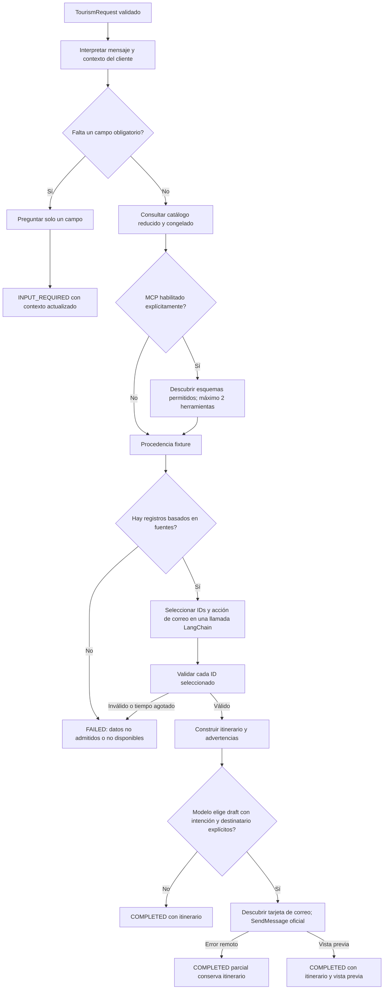
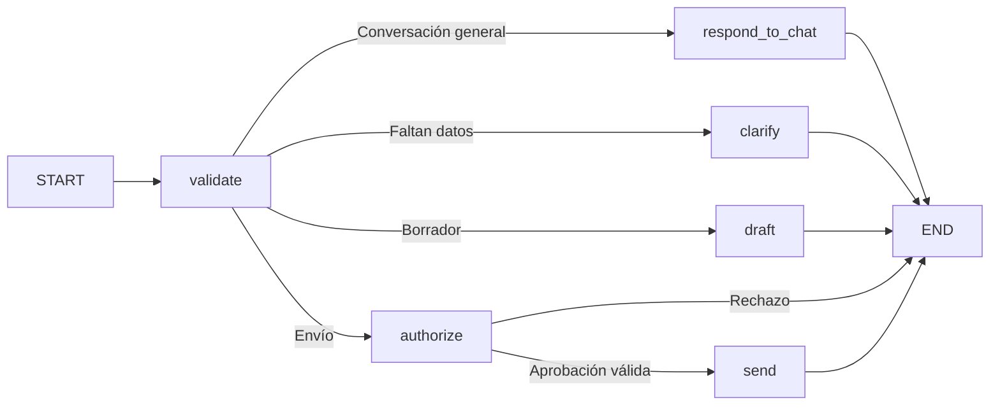
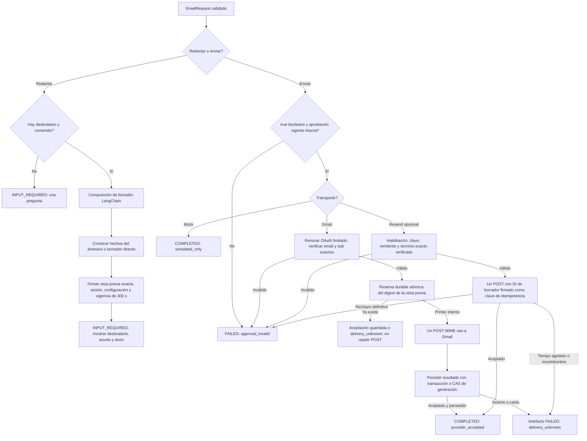

# Dos agentes con responsabilidades independientes

Turismo convierte contexto validado en una sugerencia basada en fuentes y, si se solicita, pide a correo un borrador por HTTP A2A. Correo también funciona por separado y es el único que controla la entrega. Todo envío exige consentimiento sobre una vista previa exacta.

| Componente | Proceso/contenedor | Interfaz | Autoridad |
|---|---|---|---|
| `tourism_agent` | Un servicio FastAPI | `/api/chat`, `/a2a` nativo | Aclarar, consultar, planificar y delegar borrador o confirmación |
| `email_agent` | Un servicio FastAPI | `/api/chat`, `/api/email`, `/a2a` nativo | Redactar cualquier tema, validar aprobación y enviar mediante proveedor explícito |
| API Colombia MCP | Herramienta externa pública de solo lectura | Streamable HTTP nativo | Solo hechos de catálogo |
| CLI y pruebas | Clientes de corta duración | SDK oficial A2A | Mostrar vistas previas y exigir confirmación humana |

`common` contiene contratos, composición del modelo, límites y transporte, sin importar servicios de negocio de ningún agente. Cada Dockerfile copia solo su agente y el paquete común. No hay tercer agente, servicio orquestador, base de datos central, frontend ni intermediario oculto. Correo sí usa un registro durable de intentos.

## Grafo de turismo



Ambos agentes usan grafos `StateGraph` compilados de LangGraph. Entrada, llamadas a modelo/herramientas, concurrencia y recursión tienen límites. La composición predeterminada usa Vertex ADC real y cuota explícita en example-project, global, gemini-3.1-flash-lite, pensamiento mínimo y temperatura 1. Fallas de credenciales/proveedor nunca seleccionan fixture. Las pruebas sin conexión eligen fixture y transporte mock explícitamente. Gemini selecciona IDs conocidos y `email_action` (`draft` o `none`) en la misma llamada; la aplicación valida ambos y construye actividades, enlaces y advertencias sin inventar registros, precios ni horarios. Solo el mensaje directo del usuario o campos explícitos pueden habilitar el borrador; fuentes, citas y una decisión del modelo aislada no lo autorizan.

`TripContext` viaja con el cliente y conserva ciudad, de 1 a 7 días, hasta cinco intereses e intención/destinatario explícitos durante las aclaraciones. Se valida en cada turno. El analizador es reducido; los campos estructurados siguen disponibles. Si falta el destinatario, se pregunta sin consultar catálogo, modelo o correo. Tras la vista previa se conserva `email_context`; un turno posterior se delega al agente de correo sin repetir la planificación turística. Las réplicas no necesitan memoria compartida de conversación.

La instrucción del modelo exige español neutro profesional para contenido humano, con claves, IDs, fuentes y citas exactos. La aplicación traduce etiquetas propias de actividades curadas por ID sin modificar los registros originales; nombres MCP permanecen exactos. El [README](../README.md) describe las interfaces y los límites actuales.

## Grafo de correo

La conversación general usa el mismo `StateGraph(MailState)` y el mismo límite de
ocho ejecuciones que la redacción y autorización. `converse()` ingresa al grafo;
`validate` selecciona `respond_to_chat`, que llama a LangChain, valida el texto y
termina sin acceder al transporte. Una cancelación libera el cupo compartido.
El plazo máximo sigue siendo 35 segundos y la recursión máxima, 12 pasos.



Todas las llamadas al modelo de correo quedan dentro de `respond_to_chat` o
`draft`. Este cambio no añade respaldo de modelo o proveedor ni reintentos de
envío; la autorización firmada y el registro durable conservan sus controles.



El digest de aprobación vincula destinatario, asunto, texto, remitente, transporte, sesión, ID de borrador y vencimiento. También se firma la configuración con huella de clave no expuesta. Cambiar cualquier valor rechaza el token. Vencer exige un borrador nuevo. Mock sin conexión genera claves al iniciar; reiniciar invalida vistas previas anteriores. El transporte real exige clave persistente de al menos 32 bytes. No se registran token, cuerpo, destinatario ni clave del proveedor.

`/api/chat` de correo acepta `message` y un `context` opcional, firmado con dominio separado y sin almacenamiento por instancia. El contexto conserva sesión, solicitud y vista previa exacta; no está cifrado y debe tratarse como dato privado. La primera petición prepara el borrador. Solo una confirmación natural exacta en otro turno, con contexto vigente, pasa al mismo grafo de autorización y transporte usado por `/api/email`. Negaciones, texto citado o confirmaciones con correcciones no envían; cambiar destinatario genera una nueva vista previa y cambiar contenido exige aclararlo. No hay nueva llamada al modelo para confirmar ni nuevo mecanismo de deduplicación.

Resend deduplica atómicamente mediante `Idempotency-Key: colombia-<signed-draft-id>` durante 24 horas. La aprobación dura cinco minutos; el cliente no elige esa clave. Una vista previa intacta puede reintentarse manualmente antes de vencer entre réplicas/reinicios sin deduplicación en memoria. No hay reintentos automáticos. La aceptación no garantiza buzón. Se depende del [contrato de idempotencia de Resend](https://resend.com/docs/dashboard/emails/idempotency-keys), no de una garantía general de entrega exactamente una vez.

## Interacción A2A

```mermaid
sequenceDiagram
  actor User as Persona
  participant T as Agente de itinerarios
  participant E as Agente de correo
  participant P as API Gmail seleccionada
  User->>T: SendMessage con datos JSON y contexto validado
  T-->>User: Artefacto Task INPUT_REQUIRED o COMPLETED
  Note over T: Consultar solo con datos de viaje completos
  T->>E: GET /.well-known/agent-card.json
  Note over T: Verificar URL configurada exacta; sin redirecciones
  T->>E: SDK JSONRPC SendMessage con EmailRequest draft
  E-->>T: Task INPUT_REQUIRED y vista previa firmada
  T-->>User: Itinerario y vista previa exacta
  User->>T: Sí, envíalo y context devuelto intacto
  T->>E: SendMessage tipado con mensaje y contexto firmado
  Note over E: También admite REST directo sin turismo
  E->>E: Verificar firma, sesión, vencimiento y configuración
  alt Mock
    E-->>User: COMPLETED simulated_only
  else Transporte real explícitamente configurado
    E->>E: Verificar permisos OAuth Gmail e identidad seleccionada
    E->>E: Reservar digest durable; no repetir reservas existentes
    E->>P: Un POST messages/send con MIME base64url exacto
    P-->>E: Aceptación o resultado incierto
    E-->>User: provider_accepted o delivery_unknown
  end
```

Se usa `a2a-sdk[fastapi]==1.2.2`, protocolo A2A **1.0**, protobuf `Message`, `Part`, `Task` y rutas de la fábrica oficial. El método JSONRPC es `SendMessage`, no el antiguo `message/send`. El SDK maneja `contextId`/`taskId` válidos. Aclaraciones y vistas previas producen `INPUT_REQUIRED`; payloads tipados inválidos producen tareas `FAILED` con errores propios seguros. Un resultado parcial de turismo completa la tarea conservando su itinerario utilizable.

No se admite cancelación de tareas síncronas cortas: un envío ya iniciado no puede deshacerse de forma segura. El almacenamiento nativo es efímero, limitado a 128 registros y diez minutos de inactividad; no autoriza estado de viaje ni aprobaciones. No dependa de `GetTask` después de reinicio o expulsión. Conserve el contexto tipado y la vista previa firmada y envíe un mensaje nuevo si el registro ya no existe.

## Fuentes y límites

Los hechos fixture se revisaron con fuentes primarias el **2026-10-06**. Son registros curados manualmente, no una captura de API. `source_reviewed_at` y `fixture_as_of` quedan fijos; `retrieved_at` es nulo. Solo registros MCP en vivo tienen fecha real de consulta. Fixture cubre Bogota, Medellin y Cartagena; ciudades no admitidas producen error explícito sin sustituir otro lugar.

Fuentes: [Monserrate](https://monserrate.co/en/plan-your-visit/), [Medellín oficial](https://colombia.travel/en/medellin?page=0), [arquitectura de Cartagena](https://colombia.travel/en/cartagena/colonial-architecture-cartagena). No se afirma actualidad de precios, horarios, reservas, accesibilidad, seguridad o transporte. Interés gastronómico no inventa restaurantes ausentes del catálogo.

MCP opcional solo consulta tras completar datos útiles. Usa cliente `mcp` oficial, URL pública fija, lista explícita de dos herramientas, caché de esquemas de diez minutos, resultados de quince minutos y fallas de un minuto, límite de diez segundos, resultados pequeños y validación de pertenencia a ciudad. Cambios de esquema, vacíos, tiempo agotado e indisponibilidad declaran procedencia de respaldo fixture. El texto de herramientas aporta nombres/IDs, no autoridad de acción. Una prueba autorizada tras corregir el SDK obtuvo dos registros de Cartagena; no demuestra disponibilidad continua. Los campos Python son `input_schema`, `structured_content`, `is_error`; JSON usa alias camelCase. Respaldo de catálogo no reemplaza un LLM real fallido por un modelo sin conexión.

Límites: cuerpo de solicitud 32 KiB; mensaje/borrador directo 4.000 caracteres; entrada/salida del modelo 16.000 caracteres; salida real 700 tokens; una llamada por solicitud útil; cero reintentos; 100 llamadas reales por instancia por defecto; recursión 12; concurrencia 8; grafo 35 segundos; HTTP 40 segundos. Turismo limita delegación a correo a ocho segundos para poder devolver un itinerario parcial antes del límite exterior. El contador se reinicia con el proceso y no limita gasto acumulado.

Los parámetros reales se contrastaron históricamente con [configuración Vertex en LangChain](https://docs.langchain.com/oss/python/integrations/chat/google_generative_ai) y [Gemini 3.1 Flash-Lite](https://docs.cloud.google.com/gemini-enterprise-agent-platform/models/gemini/3-1-flash-lite). La configuración faltante de correo real detiene el inicio antes del modelo. Resend es opcional; Gmail student@example.com está seleccionado; su consentimiento personal está pendiente. El despliegue sigue pendiente.

## OAuth y envío Gmail

Gmail usa una autorización Desktop independiente para student@example.com con `gmail.send`/`openid`/`email` solamente. El asistente local valida state, S256 PKCE, firma/audiencia/emisor/vencimiento/nonce y email/sub verificados antes de guardar de forma protegida. Al ejecutar, renueva en el endpoint fijo de Google y comprueba UserInfo antes de reservar el intento. Ninguna etapa usa ADC de Vertex ni tokens de conectores. Consulte la [guía](gmail-authorization.md) para el nuevo consentimiento personal y su recuperación.

Gmail no usa aquí clave de idempotencia del proveedor. SQLite local con UNIQUE y transacciones, o GCS con precondiciones de generación en Cloud Run, reserva un intento de digest opaco antes del POST. Registros enviados reproducen aceptación; `reserved`/`unknown` nunca repiten POST. Una caída entre reserva y envío puede perder un mensaje no enviado: se garantiza como máximo un intento automático, no entrega exactamente una vez. Cloud Run exige GCS dedicado compartido, nunca SQLite efímero. El registro contiene digest/ID proveedor/estado/tiempo, sin contenido, destinatario ni tokens. Resend conserva su mecanismo independiente.


## Conversación y orden directa de envío

`/api/chat` de correo responde mediante el LLM a saludos y preguntas ordinarias sin exigir campos de correo. Solo una orden directa no citada ni negada establece intención de borrador o de envío; las decisiones del modelo y los textos de fuentes no establecen autorización. La intención incompleta de correo se conserva en un contexto firmado durante 300 segundos y se pide un dato faltante por turno.

Una orden suficiente de redactar y enviar compone un preview interno, firma sus bytes y reutiliza la validación y el transporte Gmail existentes. La respuesta muestra el contenido exacto y solo declara `sent` ante aceptación durable del proveedor. Las solicitudes de borrador conservan su confirmación humana posterior. Antes de componer una orden de envío se reserva una clave opaca separada por propósito en el mismo ledger; un replay o carrera de esa continuación no vuelve a componer ni despachar. Un fallo tras reservar conserva la incertidumbre y exige revisión manual; las peticiones iniciales independientes no se deduplican por texto.

El remitente, el grant y UserInfo están ligados a student@example.com. El perfil local usa `work/gmail-oauth-personal/authorized-user.json`, pero conserva la clave y SQLite anteriores. Sin ese grant personal, el factory de correo falla antes de crear el modelo; no ofrece conversación parcialmente configurada ni fallback. Turismo puede delegar una orden completa de envío mediante `message` más itinerario tipado en A2A. Una solicitud pendiente de turismo que requirió aclaraciones conserva el camino de preview y confirmación.
